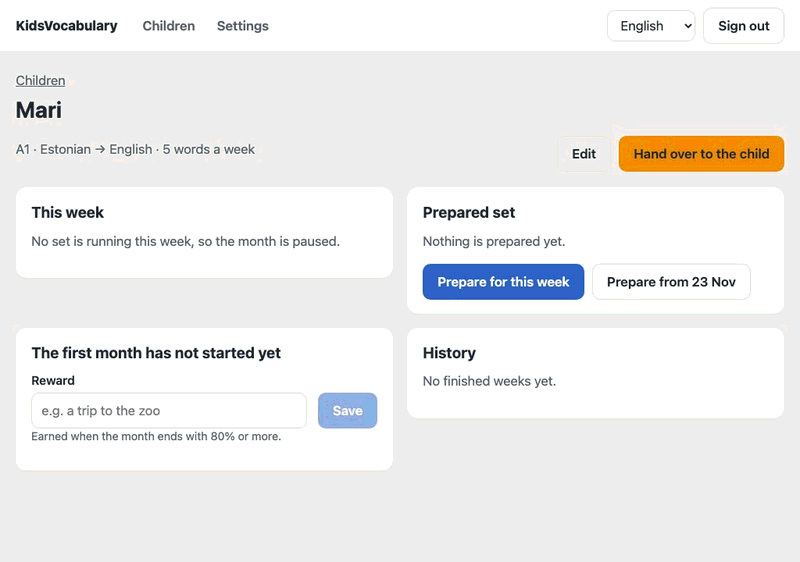
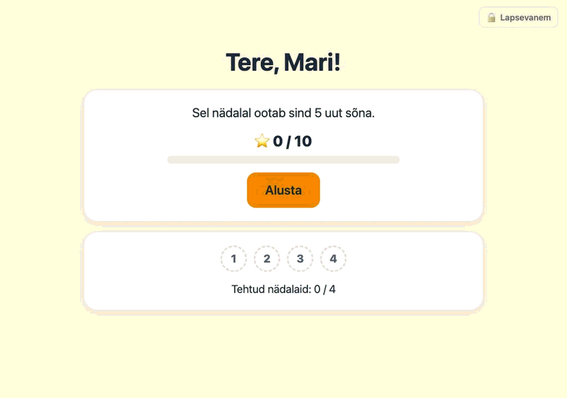

# KidsVocabulary

A web application that helps children learn foreign-language words, with a focus on spelling.

> **About this project.** KidsVocabulary is a personal project, made for my own family's use. It was built
> entirely with the help of AI: requirements, design, code, tests and documentation were written in
> conversation with an AI coding assistant, with me deciding what to build and checking the result.

A parent prepares a weekly word set (by hand, with AI suggestions, or both) and hands the tablet to the
child. The child spells each word until every word is right; points add up over a four-week "month" that
ends with a report and the reward agreed in advance. The child learns English or German; the
native language can be Russian or Estonian. German has no built-in starter dictionary: its words come from
the parent and from the AI provider, so automatic filling for German needs `AI_PROVIDER` to be set.

Architecture, domain rules and the API are described in [docs/DESIGN.md](docs/DESIGN.md).

## Demo: Estonian → English

**The parent builds a week.** A new set for this week: one word typed by hand (*päike → sun*), the rest
filled up automatically on the topic "Animals", then the week is started.



**The child trains.** The child mode speaks the child's native language (Estonian here). Each word is
spelled in English; a hint first shows the number of letters, then reveals letters one by one. After a
mistake the right spelling stays on screen for a few seconds, and the word comes back in the next round.
At the end the child sees the points for the week.



## Run with Docker

```bash
cp .env.example .env          # set JWT_SECRET (openssl rand -base64 48) so sign-ins survive a restart
docker compose up --build
```

- App: http://localhost:3000
- Backend API: http://localhost:8080/api/v1/info
- Health: http://localhost:8080/actuator/health

Stop: `docker compose down`. Stop and delete database data: `docker compose down -v`.

## Using the app

1. **Register** with an e-mail, a password and a 4–6 digit parent PIN.
2. **Add a child**: name, birth date, level (A0–A2), native language and the default number of words per week.
3. **Prepare a week** on the child's page, for this week or from next Monday:
   add words by hand (with extra accepted spellings such as *color, colour*), let the app fill up the set
   (optionally on a topic), replace or remove words. Hard words from the previous month are added
   automatically and cannot be removed.
4. **Launch** the set. A set for this week starts at once; a set for next week starts on Monday.
5. **Hand over** the tablet ("Child mode" → pick the child). The child sees everything in their native
   language, trains, gets hints and sees the right spelling after a mistake. Leaving the child mode needs
   the PIN.
6. **Follow progress**: points per week, per-word statistics, and a monthly report with hard and unlearned
   words once the fourth week is closed. Set the month's reward on the child's page.

The parent interface is available in Russian, Estonian and English (language switcher in the header).

## AI word suggestions (optional)

Without configuration, weekly sets are filled from the built-in dictionary. To let an LLM propose words,
set in `.env`:

```bash
AI_PROVIDER=gemini            # or openai-compatible (Groq by default)
AI_API_KEY=your-key
# AI_MODEL=..., AI_BASE_URL=... to override the defaults
```

Generated words are validated, stored in the shared dictionary and reused. If the provider fails or
its quota runs out, the app falls back to the dictionary and retries the provider after 5 minutes.
Only the child's age, level, languages, topic and words to avoid are sent — never names or other personal data.

## Local development (database in Docker)

Requires Java 21 and Node 22.

```bash
docker compose up -d postgres
cd backend && ./mvnw spring-boot:run
cd frontend && npm install && npm run dev     # http://localhost:5173, /api is proxied to :8080
```

## Tests

```bash
cd backend && ./mvnw test           # all tests, including integration tests (requires Docker / Testcontainers)
cd backend && ./mvnw test -Pfast    # without integration tests
cd frontend && npm test             # unit and component tests, accessibility checks (axe, colour contrast)
```

End-to-end smoke tests (Playwright) run against a running stack, on a tablet and a desktop viewport:

```bash
docker compose up -d --build
cd frontend && npx playwright install chromium   # once
npm run e2e                                      # E2E_BASE_URL=... to test another deployment
```

They register a fresh parent account (`e2e-…@example.test`) on every run, build and launch a week,
train it as the child and return to parent mode with the PIN.

The domain core (`com.kidsvocab.core`) is held at 100% line and branch coverage by a JaCoCo gate.

## Structure

```
backend/     Spring Boot 3, Java 21, Flyway, PostgreSQL
  core/      pure domain logic: answer checking, hints, scoring, rounds, week closing, monthly report
  app/       services, scheduling, AI orchestration
  web/       REST controllers (RFC 7807 errors), security/  JWT and parent/child modes
frontend/    React + TypeScript (Vite); served by nginx in Docker, /api proxied to the backend
  src/api/        HTTP client (in-memory access token, refresh cookie), DTO types
  src/features/   auth, parent (children, week builder, reports), child (home, training)
  src/i18n/       ru / et / en catalogs
  e2e/            Playwright smoke tests
docs/        design documentation
```

## Accessibility

The UI targets WCAG 2.1 AA: labelled form controls with linked hints and errors, keyboard navigation with a
skip link and focus moved to the content after navigation, dialogs that keep and return focus, page titles,
text contrast of at least 4.5:1 (checked by a test), large touch targets in the child mode and no animations
when the system asks for reduced motion.
