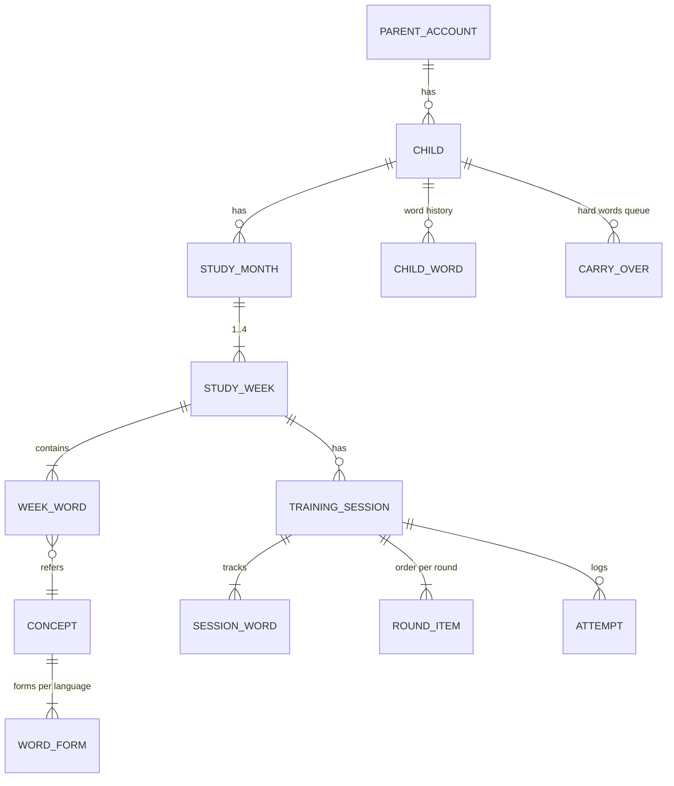

# KidsVocabulary — Design Document

A web application that helps a child learn foreign-language words and, above all, how to spell them.
A parent prepares a weekly word set (manually, with AI suggestions, or both); the child practises
until every word is spelled correctly; points accumulate over a 4-week cycle that ends with a report
and an agreed reward.

The first target language is English; native languages are Russian and Estonian. The data model
supports adding more language pairs without changing the business logic.

## 0. Product rules

| # | Rule |
|---|------|
| 1 | A week is a calendar week, Mon–Sun, in the parent's time zone (default `Europe/Tallinn`). |
| 2 | A "month" is a cycle of 4 consecutive study weeks, independent of calendar months. |
| 3 | A week without a launched word set does not count: the cycle is paused. |
| 4 | Hard words from the previous month count towards the weekly limit and are spread across the 4 weeks, at most ½ of the limit per week. |
| 5 | Within a round, problematic words are never first or last and never adjacent to each other. |
| 6 | If rule 5 cannot be satisfied (too few words), it is relaxed. |
| 7 | Training progress is stored on the server; the child can stop and resume. One attempt = one round. |
| 8 | If the first pass is not finished by the end of the week (Sun 23:59), words **not yet spelled correctly** (wrong or unanswered) get 0 points and the "unlearned" status. Words already spelled correctly keep their points. |
| 9 | A word may have several accepted answers (synonyms, colour/color). |
| 10 | Using a hint (any number of presses) lowers the word's score by one level, minimum 0.5. Letters are revealed left to right, at most `length − 1`. |
| 11 | Revealed letters reset in the next round; the "hint used" flag sticks to the word. |
| 12 | Hard word = final score 0.5 (includes every "problematic" word). Unlearned = 0. |
| 13 | One parent login; switch to a child profile; returning to parent mode requires a PIN. |
| 14 | A word set is frozen when the week is launched. |
| 15 | A child profile has a birth date and a level (A0/A1/A2). |
| 16 | "Child-appropriate vocabulary" = stop list + length + alphabet + topic whitelist + language-pair check. |
| 17 | Runs locally with Docker Compose; no decisions that would block internet deployment later. |
| 18 | The child UI uses the child's native language (ru/et); the parent UI is localised as well. i18n from day one. |

**Additional rules:**

- **A1.** A set can be launched mid-week; it still ends on that Sunday (a shorter week). Alternatively the parent picks "from next Monday" (status `SCHEDULED`).
- **A2.** The parent can prepare next week's set in advance (draft → `SCHEDULED`, becomes `ACTIVE` on Monday). If there is no set by Monday, the system creates a **draft** (carried-over words + AI/dictionary suggestions). A draft is never launched automatically (that would break rule 3); the parent reviews it and presses "Launch".
- **A3.** The monthly report is produced as soon as week 4 is closed (first pass finished or week expired).
- **A4.** After a wrong answer the correct spelling is shown for **5 seconds** (setting `app.training.show-correct-answer-seconds=5`).
- **A5.** An empty answer (accidental tap) is not counted as an attempt.
- **A6.** Backend build: Maven; frontend: Vite + React + TypeScript.

---

## 1. Domain model and database schema

### 1.1 Multilingual core idea

A word is stored as a **concept** (`concept`) with a set of **word forms** in different languages (`word_form`). For a "native → target" pair, the primary native form is the prompt and all target forms are accepted answers. Adding German = new rows in `language` and `word_form`; the logic does not change. Answer normalisation is a per-language strategy (`AnswerNormalizer`); prompt templates are per language pair.

### 1.2 Entities



| Entity | Purpose |
|---|---|
| `ParentAccount` | Account, parent-mode PIN, time zone |
| `Child` | Profile: name, native/target language, level, birth date, default week size |
| `Concept` / `WordForm` | Shared dictionary (seed + AI) and the parent's own words |
| `StudyMonth` | 4-week cycle, reward, results (report snapshot) |
| `StudyWeek` | Word set for a calendar week, status, points |
| `WeekWord` | Frozen word of the week (prompt, accepted answers) + first-pass result |
| `TrainingSession` | A run through the week: `FIRST_PASS` (one per week, scores points) or `PRACTICE` |
| `SessionWord` | Per-word state in a session: mistakes, hint, problematic, round solved in |
| `RoundItem` | Word order within a round (to resume at the same place) |
| `Attempt` | Answer log (statistics, idempotency) |
| `ChildWord` | The child's history per word: learned/hard/unlearned → avoids repeats in AI suggestions |
| `CarryOver` | Queue of hard/unlearned words for the next month |

### 1.3 Statuses

- `StudyWeek.status`: `DRAFT → SCHEDULED → ACTIVE → COMPLETED | EXPIRED`
  - `COMPLETED` — first pass finished; `EXPIRED` — week ended before the first pass was finished (rule 8).
  - A `DRAFT` can be created for the current or any future week (A2).
- `StudyMonth.status`: `ACTIVE → COMPLETED`; `result`: `REWARD (≥80%) | GOOD (60–79.99%) | REPEAT (<60%)`.
- `WeekWord.outcome`: `LEARNED | HARD | UNLEARNED`.
- `TrainingSession.status`: `IN_PROGRESS | COMPLETED | CLOSED` (closed by week expiry).

### 1.4 Database schema (PostgreSQL, Flyway)

```sql
create table language (
  code varchar(5) primary key,            -- 'ru','et','en'
  name varchar(50) not null
);

create table parent_account (
  id            bigserial primary key,
  email         varchar(255) not null unique,
  password_hash varchar(100) not null,
  pin_hash      varchar(100),               -- parent-mode PIN
  timezone      varchar(50) not null default 'Europe/Tallinn',
  created_at    timestamptz not null default now()
);

create table refresh_token (
  id         bigserial primary key,
  parent_id  bigint not null references parent_account(id) on delete cascade,
  token_hash varchar(100) not null unique,
  expires_at timestamptz not null,
  revoked    boolean not null default false
);

create table child (
  id                bigserial primary key,
  parent_id         bigint not null references parent_account(id) on delete cascade,
  name              varchar(50) not null,
  birth_date        date,
  level             varchar(2) not null default 'A0',   -- A0/A1/A2
  native_lang       varchar(5) not null references language(code),
  target_lang       varchar(5) not null references language(code),
  default_week_size smallint not null default 10 check (default_week_size between 1 and 50),
  archived          boolean not null default false,
  created_at        timestamptz not null default now(),
  check (native_lang <> target_lang)
);

create table concept (
  id              bigserial primary key,
  topic           varchar(40),
  difficulty      smallint not null default 1,          -- 1..3
  origin          varchar(10) not null,                 -- SEED/AI/MANUAL
  owner_parent_id bigint references parent_account(id) on delete cascade, -- null = shared dictionary
  created_at      timestamptz not null default now()
);

create table word_form (
  id         bigserial primary key,
  concept_id bigint not null references concept(id) on delete cascade,
  lang       varchar(5) not null references language(code),
  text       varchar(60) not null,
  normalized varchar(60) not null,
  is_primary boolean not null default false,
  unique (concept_id, lang, normalized)
);
create index ix_word_form_lookup on word_form(lang, normalized);
create unique index ux_word_form_primary on word_form(concept_id, lang) where is_primary;

create table study_month (
  id           bigserial primary key,
  child_id     bigint not null references child(id) on delete cascade,
  seq_no       int not null,
  status       varchar(10) not null,                 -- ACTIVE/COMPLETED
  reward_text  varchar(255),
  total_points numeric(6,1),
  max_points   numeric(6,1),
  percent      numeric(5,2),
  result       varchar(10),                          -- REWARD/GOOD/REPEAT
  report       jsonb,                                -- report snapshot
  completed_at timestamptz,
  unique (child_id, seq_no)
);
create unique index ux_month_active on study_month(child_id) where status = 'ACTIVE';

create table study_week (
  id                      bigserial primary key,
  month_id                bigint not null references study_month(id) on delete cascade,
  child_id                bigint not null references child(id) on delete cascade,
  week_index              smallint check (week_index between 1 and 4), -- assigned on launch
  start_date              date not null,             -- Monday
  end_date                date not null,             -- Sunday
  status                  varchar(10) not null,      -- DRAFT/SCHEDULED/ACTIVE/COMPLETED/EXPIRED
  word_count              smallint not null,
  launched_at             timestamptz,
  first_pass_completed_at timestamptz,
  points                  numeric(5,1),
  max_points              numeric(5,1)
);
create unique index ux_week_child_date on study_week(child_id, start_date) where status <> 'DRAFT';

create table week_word (
  id               bigserial primary key,
  week_id          bigint not null references study_week(id) on delete cascade,
  concept_id       bigint not null references concept(id),
  source           varchar(12) not null,             -- MANUAL/AI/DICTIONARY/CARRY_OVER
  prompt_text      varchar(60) not null,             -- frozen on launch
  primary_answer   varchar(60) not null,
  accepted_answers text[] not null,                  -- normalised
  -- first-pass result:
  attempt_no       smallint,                         -- round in which it was solved
  hint_used        boolean,
  problematic      boolean,
  points           numeric(2,1),
  outcome          varchar(10),                      -- LEARNED/HARD/UNLEARNED
  unique (week_id, concept_id)
);

create table training_session (
  id            bigserial primary key,
  week_id       bigint not null references study_week(id) on delete cascade,
  kind          varchar(12) not null,                -- FIRST_PASS/PRACTICE
  status        varchar(12) not null,                -- IN_PROGRESS/COMPLETED/CLOSED
  current_round int not null default 1,
  seed          bigint not null,                     -- reproducible shuffling
  started_at    timestamptz not null default now(),
  completed_at  timestamptz,
  version       int not null default 0               -- optimistic locking
);
create unique index ux_first_pass on training_session(week_id) where kind = 'FIRST_PASS';

create table session_word (
  session_id   bigint not null references training_session(id) on delete cascade,
  week_word_id bigint not null references week_word(id) on delete cascade,
  wrong_count  smallint not null default 0,
  hint_used    boolean not null default false,
  problematic  boolean not null default false,
  solved_round int,
  primary key (session_id, week_word_id)
);

create table round_item (
  session_id   bigint not null references training_session(id) on delete cascade,
  round_no     int not null,
  position     int not null,
  week_word_id bigint not null references week_word(id) on delete cascade,
  hint_letters smallint not null default 0,
  answered     boolean not null default false,
  primary key (session_id, round_no, position)
);

create table attempt (
  id           bigserial primary key,
  session_id   bigint not null references training_session(id) on delete cascade,
  week_word_id bigint not null references week_word(id) on delete cascade,
  round_no     int not null,
  answer_text  varchar(100) not null,
  correct      boolean not null,
  hint_letters smallint not null,
  created_at   timestamptz not null default now(),
  unique (session_id, week_word_id, round_no)        -- protects against double submit
);

create table child_word (
  child_id      bigint not null references child(id) on delete cascade,
  concept_id    bigint not null references concept(id),
  status        varchar(10) not null,                -- LEARNED/HARD/UNLEARNED
  times_studied int not null default 1,
  last_week_id  bigint references study_week(id),
  updated_at    timestamptz not null default now(),
  primary key (child_id, concept_id)
);

create table carry_over (
  id              bigserial primary key,
  child_id        bigint not null references child(id) on delete cascade,
  concept_id      bigint not null references concept(id),
  from_month_id   bigint not null references study_month(id),
  target_month_id bigint references study_month(id), -- null = not yet placed
  reason          varchar(10) not null,              -- HARD/UNLEARNED
  unique (child_id, concept_id, from_month_id)
);

create table ai_request_log (
  id         bigserial primary key,
  provider   varchar(30) not null,
  status     varchar(20) not null,                   -- OK/INVALID/ERROR/RATE_LIMIT
  words_in   int, words_valid int,
  latency_ms int,
  error      text,
  created_at timestamptz not null default now()
);
```

Migrations: `V1__language.sql` (languages), `V2__schema.sql` (remaining tables), `V3__seed_dictionary.sql` — a starter dictionary of ~400 ru/et/en concepts grouped by topic (animals, food, family, school, colours, numbers, home, clothes, body, weather, transport, toys, nature, actions).

---

## 2. REST API

Prefix `/api/v1`. JSON. Errors use `application/problem+json` (RFC 7807).

### 2.1 Authentication and modes

JWT access token (15 min) + refresh token (30 days, httpOnly cookie). The access token carries a `mode` claim:
- `PARENT` — full access to the account;
- `CHILD` + `childId` — only training and progress of that child.

| Method | Path | Description |
|---|---|---|
| POST | `/auth/register` | email, password, PIN |
| POST | `/auth/login` | → access token (`PARENT`) + refresh cookie |
| POST | `/auth/refresh` | refresh the access token |
| POST | `/auth/logout` | revoke the refresh token |
| POST | `/auth/switch-to-child/{childId}` | (PARENT) → `CHILD` token |
| POST | `/auth/switch-to-parent` | `{pin}` → `PARENT` token; rate-limited |
| PUT | `/account/pin` | (PARENT) change the PIN |

### 2.2 Parent (mode = PARENT)

| Method | Path | Description |
|---|---|---|
| GET/POST | `/children` | list / create a child |
| GET/PUT/DELETE | `/children/{id}` | profile (DELETE = archive) |
| GET | `/children/{id}/weeks?from&to` | weeks (calendar) |
| POST | `/children/{id}/weeks` | `{startDate, wordCount}` → draft; carried-over words are added immediately |
| GET | `/weeks/{weekId}` | set + status |
| PUT | `/weeks/{weekId}` | change `wordCount`/date (DRAFT only) |
| POST | `/weeks/{weekId}/words` | add manually `{source, target, extraAnswers[], topic?}` |
| DELETE | `/weeks/{weekId}/words/{wordId}` | remove a word |
| POST | `/weeks/{weekId}/words/{wordId}/replace` | `{topic?}` → replace with another suggestion |
| PUT | `/weeks/{weekId}/words/{wordId}` | edit text / extra answers |
| POST | `/weeks/{weekId}/suggest` | `{topic?}` fill up to `wordCount` (AI → dictionary fallback); response includes `provider`: `AI`/`DICTIONARY` |
| POST | `/weeks/{weekId}/launch` | `{when: NOW|NEXT_MONDAY}` → `ACTIVE`/`SCHEDULED`; checks: word count = wordCount, no overlapping weeks |
| GET | `/children/{id}/months` | list of months |
| GET | `/months/{monthId}` | month progress (current points, weeks) |
| PUT | `/months/{monthId}/reward` | `{text}` reward |
| GET | `/months/{monthId}/report` | final report (after closing) |
| GET | `/weeks/{weekId}/stats` | per word: attempts, hints, problematic |
| GET | `/dictionary/topics?lang=` | topics for suggestions |

### 2.3 Child (mode = CHILD, or PARENT for viewing)

| Method | Path | Description |
|---|---|---|
| GET | `/me/home` | current week, week/month points, status, whether training is available |
| POST | `/weeks/{weekId}/sessions` | start or resume. If the first pass is unfinished it is returned, otherwise a `PRACTICE` session is created |
| GET | `/sessions/{id}/current` | current item: `{weekWordId, roundNo, position, prompt, answerLength, hintMask, roundSize, remainingInRound, roundsTotalSoFar}` |
| POST | `/sessions/{id}/answers` | `{weekWordId, roundNo, answer}` → `{correct, correctAnswer?, pointsPreview?, becameProblematic, roundFinished, sessionFinished, next?}` |
| POST | `/sessions/{id}/hint` | `{weekWordId, roundNo}` → `{hintMask: "c _ _"}` |
| GET | `/sessions/{id}/summary` | result: points (FIRST_PASS), words by outcome |

`answers` is idempotent on `(session, weekWord, round)`: a repeated submission returns the stored result. Answering a word that is not current → `409`.

---

## 3. Algorithms (pseudocode)

The core is plain Java without Spring (`core/training`, `core/scoring`, `core/month`); randomness and time are injected → deterministic tests.

### 3.1 Answer normalisation and checking

```
normalize(s, lang):
    s = NFC(s)
    s = replace ’ ‘ ` → '   ;  – — → -
    s = trim(s)
    s = collapseInnerSpaces(s)          // "ice  cream" → "ice cream"
    s = toLowerCase(s, locale(lang))
    return s

isCorrect(answer, weekWord):
    return normalize(answer) ∈ weekWord.acceptedAnswers   // normalised at launch
```

### 3.2 Scoring

```
basePoints(attemptNo):            // attemptNo = round in which the word was solved (1..)
    if attemptNo == 1: return 2
    if attemptNo == 2: return 1
    return 0.5

points(attemptNo, hintUsed):
    p = basePoints(attemptNo)
    if hintUsed: p = lowerLevel(p)  // 2→1, 1→0.5, 0.5→0.5
    return p

outcome(word):
    if not solved: return UNLEARNED         // 0 points
    if points == 0.5: return HARD            // includes all problematic words
    return LEARNED
```

| Round | no hint | with hint |
|---|---|---|
| 1 | 2 | 1 |
| 2 | 1 | 0.5 |
| ≥3 | 0.5 | 0.5 |
| not solved | 0 | 0 |

### 3.3 Training (rounds)

```
startSession(week, kind):
    if kind == FIRST_PASS and week.status != ACTIVE: error
    session = new(round=1, seed=random)
    for w in week.words: sessionWord[w] = {wrong=0, hint=false, problematic=false, solved=null}
    round_items(1) = shuffle(week.words, rnd(seed, 1))      // no problematic words in round 1
    return session

currentItem(session):
    return first round_item of session.currentRound where not answered

submitAnswer(session, weekWordId, roundNo, answer):
    if week expired and session.kind == FIRST_PASS: closeAsExpired(); error WEEK_EXPIRED
    if attempt exists (session, weekWordId, roundNo): return previous result   // idempotency
    item = currentItem(session)
    if item.weekWordId != weekWordId or roundNo != session.currentRound: error 409
    if isBlank(answer): return {ignored}                       // A5
    sw = sessionWord[weekWordId]
    correct = isCorrect(answer, word)
    save attempt
    item.answered = true
    if correct:
        sw.solved = roundNo
    else:
        sw.wrong += 1
        if sw.wrong == 3: sw.problematic = true                // 3 failed rounds
    if round has unanswered items: return result + next
    return finishRound(session)

finishRound(session):
    pending = [w for w in words if sessionWord[w].solved == null]
    if pending is empty:
        session.status = COMPLETED
        if session.kind == FIRST_PASS: finalizeWeek(week, session)
        return sessionFinished
    session.currentRound += 1
    round_items(session.currentRound) = arrange(pending, rnd(seed, currentRound))
    return roundFinished

hint(session, weekWordId, roundNo):
    item = currentItem; check that it is this word
    maxLetters = letterCount(word.primaryAnswer) - 1
    item.hintLetters = min(item.hintLetters + 1, maxLetters)
    sessionWord.hint = true                  // sticks until the end of the session (rule 11)
    return mask(primaryAnswer, item.hintLetters)  // spaces and hyphens always visible: "i _ _   c _ _ _ _"
```

### 3.4 Placing problematic words within a round

```
arrange(words, rnd):
    P = shuffle([w for w in words if problematic], rnd)
    N = shuffle([w for w in words if not problematic], rnd)
    if P is empty: return N
    if N is empty: return P                                  // constraint impossible (rule 6)

    innerGaps = N.size - 1                                   // gaps between regular words
    if P.size <= innerGaps:
        gaps = randomDistinct(1..innerGaps, P.size, rnd)     // not first, not last, not adjacent
    else if P.size <= N.size + 1:
        gaps = randomDistinct(0..N.size, P.size, rnd)        // edges allowed, still not adjacent
    else:
        gaps = distributeEvenly(P.size over 0..N.size)       // minimise adjacency
    return interleave(N, P, gaps)
```

Round 1 uses a Fisher–Yates shuffle with `Random(seed ^ round)`, so the order can be reproduced after a server restart (and `round_item` stores it explicitly).

### 3.5 Closing a week

```
finalizeWeek(week, firstPassSession):         // first pass finished
    for w in week.words:
        sw = sessionWord[w]
        w.attemptNo = sw.solved; w.hintUsed = sw.hint; w.problematic = sw.problematic
        w.points = points(sw.solved, sw.hint); w.outcome = outcome(w)
        upsert childWord(child, w.concept, w.outcome)
    week.points = Σ w.points; week.maxPoints = 2 × week.wordCount
    week.status = COMPLETED
    if week.weekIndex == 4: closeMonth(week.month)

expireWeeks(now):                              // @Scheduled every 15 min + lazy check on request
    for week in ACTIVE where now > endOfDay(week.endDate, parent.timezone):
        sessionWords = FIRST_PASS session words (empty if never started)
        for w in week.words:                                          // rule 8
            sw = sessionWords[w]
            if sw != null and sw.solved != null:                      // already spelled correctly
                w.points = points(sw.solved, sw.hint); w.outcome = outcome(w)
            else:                                                     // wrong or unanswered
                w.points = 0; w.outcome = UNLEARNED
            upsert childWord(child, w.concept, w.outcome)
        close FIRST_PASS session (CLOSED), if any
        week.points = Σ w.points; week.maxPoints = 2 × week.wordCount
        week.status = EXPIRED
        if week.weekIndex == 4: closeMonth(week.month)
    for week in SCHEDULED where today >= week.startDate: activate(week)
```

### 3.6 Monthly report and carry-over

```
closeMonth(month):
    weeks = month.weeks (4, COMPLETED|EXPIRED)
    total = Σ week.points ; max = Σ week.maxPoints
    percent = total / max × 100                // exact (BigDecimal), rounded for display only
    result = percent ≥ 80 ? REWARD : percent ≥ 60 ? GOOD : REPEAT
    hard      = words with outcome HARD
    unlearned = words with outcome UNLEARNED
    report = {total, max, percent, result, reward: month.rewardText if REWARD,
              weeks: [{index, dates, points, max, percent, learned, hard, unlearned}],
              hardWords, unlearnedWords}
    for c in distinct(hard ∪ unlearned by concept): insert carry_over(c, reason)
    month.status = COMPLETED
    create next month (seq+1, ACTIVE)

planCarryOver(month, weekLimit):               // when a week draft is created
    queue = carry_over where target_month is null or == month, not yet placed
    cap = floor(weekLimit / 2)
    weeksLeft = 4 - launchedWeeksInMonth
    if queue.size > cap × weeksLeft: cap = min(weekLimit, ceil(queue.size / weeksLeft))
    take = min(cap, ceil(queue.size / weeksLeft))  // spread evenly
    add first `take` words (UNLEARNED before HARD) to the draft with source CARRY_OVER
    // if there are more words than 4 × limit, the rest moves on to the following month
```

### 3.7 Edge cases

| Case | Behaviour |
|---|---|
| Empty answer | Not counted as an attempt (A5) |
| Double submit / two tabs | Unique key on `attempt` + optimistic locking on the session; a repeat returns the stored result |
| Answer for a word that is not current | `409 Conflict`; the client re-fetches `current` |
| Week expires during training | Next answer → `WEEK_EXPIRED`, session `CLOSED`, week `EXPIRED`; solved words keep their points, the rest get 0 and "unlearned" (rule 8) |
| Child never started training | All words get 0 and "unlearned" |
| Re-training a completed week | `PRACTICE` session; points and `child_word` are not changed |
| Training an expired week | Allowed as `PRACTICE` |
| One-letter word (`I`, `a`) | No hint available (max = 0); the UI button is disabled |
| Two-word answer (`ice cream`) | Spaces are visible in the mask; inner spaces are collapsed when checking |
| Synonyms | Any form in `accepted_answers` is accepted; the hint uses the primary form |
| One word left and it is problematic | A one-word round (constraint relaxed) |
| Child keeps getting it wrong | Training continues; hints reveal up to `len − 1` letters and the correct answer is shown after a mistake (A4) |
| Week launched on Wednesday | Ends on Sunday (A1) |
| Launching a week that overlaps an active one | `409` |
| Fewer words than `wordCount` | Launch is rejected (`422`), "Fill up" is suggested |
| Duplicate concept in a set / in the current month | Rejected when adding |
| Child's native language changed mid-month | Rejected while a week is active |
| Time zone / DST | Week boundaries use `parent.timezone`; storage in `timestamptz` |
| Carry-over > 4 × limit | The remainder waits for the following month |
| No reward set and the result is ≥ 80% | The report shows "No reward set"; the parent gets a reminder |

### 3.8 Unit test coverage (core — 100% lines and branches, JaCoCo gate)

Implemented in `com.kidsvocab.core` (`text`, `scoring`, `training`, `week`, `month`); `mvn test` fails if coverage drops below 100%.

- `ScoringPolicyTest` — the whole table in 3.2, parameterised.
- `AnswerNormalizerTest`, `WordCardTest` — case, whitespace, apostrophes, dashes, Unicode, synonyms.
- `HintMaskTest` — mask, separators, `len − 1` limit.
- `TrainingSessionTest` — everything right in round 1; mistakes → rounds; "problematic" exactly on the 3rd mistake; hints reset per round with a sticky flag; idempotency; empty answer; conflicts; closing.
- `RoundArrangerTest` — "not at the edges and not adjacent" property (property-based, jqwik) + every relaxation branch.
- `WeekSummarizerTest` — rule 8: solved words keep points, unsolved and unanswered get 0; session never started. Completed and expired weeks share one rule.
- `WeekCalendarTest` — Mon–Sun boundaries, deadline in the parent's zone, DST.
- `MonthReportCalculatorTest` — boundaries 59.99/60/79.99/80, exact vs displayed percentage, carry-over precedence.
- `CarryOverPlannerTest` — distribution, cap, overflow.

---

## 4. Free AI API for word suggestions

The load is tiny: 1–3 requests per child per week, ~1–2 KB per response, so any free tier is enough. The key criterion is **Estonian language quality**.

> Free-tier limits change often. The figures below are approximate and must be re-checked against current documentation before implementation.

| Provider | Models | Limits (order of magnitude) | Pros | Cons |
|---|---|---|---|---|
| **Google Gemini API** (AI Studio) | Gemini Flash / Flash-Lite | ~10–15 req/min, hundreds–1000+ per day | Best ru/et quality among free options; native structured output (JSON Schema); OpenAI-compatible endpoint | Free-tier data may be used for training; free access is region-restricted |
| **Groq** | Llama, Qwen, GPT-OSS, etc. | ~30 req/min, ~1000+ per day | Very fast; OpenAI-compatible API; JSON mode | Noticeably weaker Estonian; model list changes |
| **OpenRouter** (`:free` models) | various open models | ~20 req/min, ~50 per day (more after a one-off top-up) | One key, many models; handy for experiments | Low daily limit; free models are unstable |
| **Mistral** (free tier) | Mistral Small, etc. | low RPS, large monthly token budget | OpenAI-like API, EU provider | Average Estonian |
| **Cloudflare Workers AI** | Llama, etc. | daily "neuron" quota | Free with an account | Weaker on small languages; its own API format |

**Recommendation:** primary provider **Gemini Flash** (structured output + best Estonian), fallback **Groq**.

Implementation:

```java
public interface WordSuggestionProvider {
    String id();
    List<SuggestedWord> suggest(SuggestionRequest request) throws ProviderUnavailableException;
}
record SuggestionRequest(int childAge, Level level, Optional<String> topic, int count,
                         Lang nativeLang, Lang targetLang, Set<String> excludeTargetWords) {}
record SuggestedWord(String source, String target, String topic) {}
```

- `GeminiWordSuggestionProvider` and `OpenAiCompatibleWordSuggestionProvider` (Groq/OpenRouter/Mistral — one class, different `base-url`/`model`).
- Provider selection: `app.ai.provider=gemini|openai-compatible|none`; the key is `AI_API_KEY` in `.env`.
- `WordSuggestionService`: AI → validation → one retry (with an extended exclusion list) → fill up from the local dictionary (`DictionaryWordSource`). 10 s timeout, circuit breaker (Resilience4j).
- **Response validation:** JSON matches the schema; exactly the expected fields; non-empty strings; only letters of the language's alphabet (ru — Cyrillic; et — Latin + õäöüšž; en — a–z) plus space/hyphen/apostrophe; length ≤ 20, at most 2 words; source ≠ target; no duplicates within the response, with already learned words (`child_word`), with the current month or set; stop list; topic from the whitelist.
- Valid words are saved to `concept`/`word_form` (origin = AI): a match on the normalised form reuses the existing concept.
- Only age (a number), level, languages, topic, count and the exclusion list are sent to the AI — **no names or personal data**.
- Tests: WireMock for HTTP (success, invalid JSON, duplicates, stop-list words, 429, timeout) and a Mockito mock provider for the service (fallback, retry).

---

## 5. MVP milestones

Each milestone ends in a working state with green tests and a demo.

| Milestone | Scope | Outcome |
|---|---|---|
| **0. Skeleton** | Repo with `backend/` (Maven, Spring Boot 3, Java 21) + `frontend/` (Vite, React, TS); `docker-compose.yml` (postgres, backend, frontend/nginx); `.env.example`; Flyway baseline; health checks | `docker compose up` starts an empty app |
| **1. Domain core** | Plain Java: normalisation, checking, hints, scoring, rounds, placement, week closing, monthly report, carry-over; JaCoCo gate 100% on `core` | Fully tested core, no database |
| **2. Database and auth** | Migrations V1–V3 (schema, languages, seed dictionary ~400 words); JPA entities; register/login/refresh; PIN and mode switching; Testcontainers | Parent login, child profiles |
| **3. Weekly sets (API)** | Week CRUD, manual words, dictionary-based suggestions, carry-over, launch/scheduling, Monday auto-draft, expiry scheduler | A week can be built and launched via the API |
| **4. AI provider** | Interface, Gemini + OpenAI-compatible, validation, saving to the dictionary, fallback, request log, WireMock/mock tests | "Fill with AI" works; without a key — dictionary |
| **5. Training and reports (API)** | Sessions, answers, hints, resuming, week/month closing, report, statistics | Full cycle via the API |
| **6. Parent UI** | Login, children, week builder (manual entry + "Fill up" + "Replace"), reward, progress, monthly report | The parent works in the browser |
| **7. Child UI** | Profile picker, home screen (points, progress), training screen: large word, large input, visual feedback (colour/icon/animation), hint, summary; tablet-first | The child trains on a tablet |
| **8. Polish** | ru/et i18n, accessibility, error handling/offline retry, e2e smoke (Playwright), README | MVP done |

Out of MVP scope (later): word pronunciation (Web Speech API), pictures for words, PWA/offline, more target languages, separate child login, parent notifications.

### Project layout

```
KidsVocabulary/
  docker-compose.yml  .env.example  README.md
  docs/DESIGN.md
  backend/
    pom.xml
    src/main/java/com/kidsvocab/
      core/        # pure domain logic (no Spring): training, scoring, month, text
      domain/      # JPA entities, repositories
      app/         # orchestration services, scheduler
      ai/          # WordSuggestionProvider + implementations
      web/         # controllers, DTOs, error handling
      security/    # JWT, PARENT/CHILD modes
    src/main/resources/db/migration/
  frontend/
    src/{api, features/parent, features/child, i18n, components}
```
