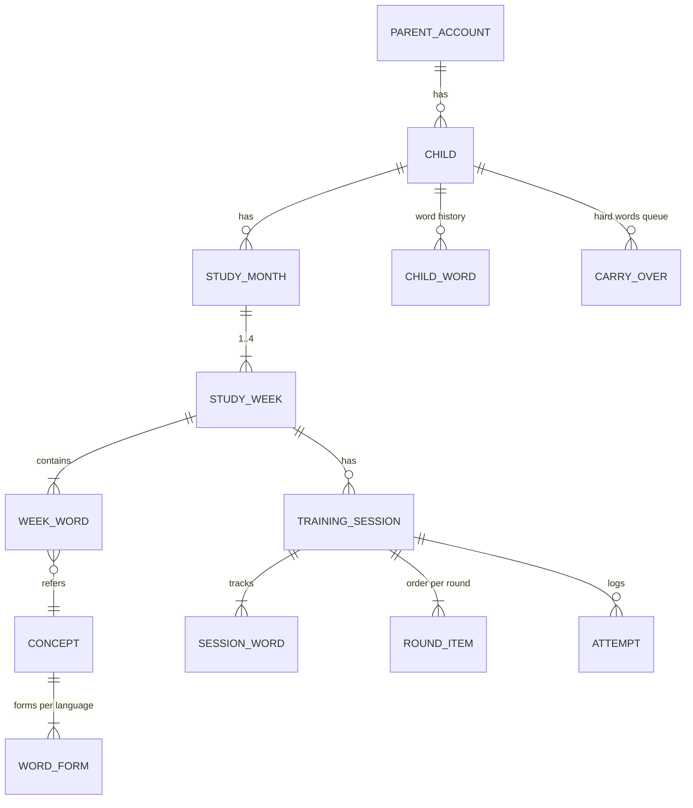

# KidsVocabulary — Design Document

A web application that helps a child learn foreign-language words and, above all, how to spell them.
A parent prepares a weekly word set (manually, with AI suggestions, or both); the child practises
until every word is spelled correctly; points accumulate over a 4-week cycle that ends with a report
and an agreed reward.

The first target language is English; native languages are Russian and Estonian. The data model
supports adding more language pairs without changing the business logic.

## 0. Product rules

| # | Rule |
|---|------|
| 1 | A week is a calendar week, Mon–Sun, in the parent's time zone (default `Europe/Tallinn`). |
| 2 | A "month" is a cycle of 4 consecutive study weeks, independent of calendar months. |
| 3 | A week without a launched word set does not count: the cycle is paused. |
| 4 | Hard words from the previous month count towards the weekly limit and are spread across the 4 weeks, at most ½ of the limit per week. |
| 5 | Within a round, problematic words are never first or last and never adjacent to each other. |
| 6 | If rule 5 cannot be satisfied (too few words), it is relaxed. |
| 7 | Training progress is stored on the server; the child can stop and resume. One attempt = one round. |
| 8 | If the first pass is not finished by the end of the week (Sun 23:59), words **not yet spelled correctly** (wrong or unanswered) get 0 points and the "unlearned" status. Words already spelled correctly keep their points. |
| 9 | A word may have several accepted answers (synonyms, colour/color). |
| 10 | Hints come in steps: the first shows only how many letters the word has (the length is not shown before), each further step reveals one more letter at a random position, at most `length − 1` letters. Any hint step (any number of presses) lowers the word's score by one level, minimum 0.5. |
| 11 | Hint steps reset in the next round (the length is hidden again, letter positions are drawn anew); the "hint used" flag sticks to the word. |
| 12 | Hard word = final score 0.5 (includes every "problematic" word). Unlearned = 0. |
| 13 | One parent login; switch to a child profile; returning to parent mode requires a PIN. |
| 14 | A word set is frozen when the week is launched. |
| 15 | A child profile has a birth date and a level (A0/A1/A2). |
| 16 | "Child-appropriate vocabulary" = stop list + length + alphabet + topic whitelist + language-pair check. |
| 17 | Runs locally with Docker Compose; no decisions that would block internet deployment later. |
| 18 | The child UI uses the child's native language (ru/et); the parent UI is localised as well. i18n from day one. |

**Additional rules:**

- **A1.** A set can be launched mid-week; it still ends on that Sunday (a shorter week). Alternatively the parent picks "from next Monday" (status `SCHEDULED`).
- **A2.** The parent can prepare next week's set in advance (draft → `SCHEDULED`, becomes `ACTIVE` on Monday). If there is no set by Monday, the system creates a **draft** (carried-over words + AI/dictionary suggestions). A draft is never launched automatically (that would break rule 3); the parent reviews it and presses "Launch".
- **A3.** The monthly report is produced as soon as week 4 is closed (first pass finished or week expired).
- **A4.** After a wrong answer the correct spelling is shown for **5 seconds** (setting `app.training.show-correct-answer-seconds=5`).
- **A5.** An empty answer (accidental tap) is not counted as an attempt.
- **A6.** Backend build: Maven; frontend: Vite + React + TypeScript.

---

## 1. Domain model and database schema

### 1.1 Multilingual core idea

A word is stored as a **concept** (`concept`) with a set of **word forms** in different languages (`word_form`). For a "native → target" pair, the primary native form is the prompt and all target forms are accepted answers. Adding German = new rows in `language` and `word_form`; the logic does not change. Answer normalisation is a per-language strategy (`AnswerNormalizer`); prompt templates are per language pair.

### 1.2 Entities



| Entity | Purpose |
|---|---|
| `ParentAccount` | Account, parent-mode PIN, time zone |
| `Child` | Profile: name, native/target language, level, birth date, default week size |
| `Concept` / `WordForm` | Shared dictionary (seed + AI) and the parent's own words |
| `StudyMonth` | 4-week cycle, reward, results (report snapshot) |
| `StudyWeek` | Word set for a calendar week, status, points |
| `WeekWord` | Frozen word of the week (prompt, accepted answers) + first-pass result |
| `TrainingSession` | A run through the week: `FIRST_PASS` (one per week, scores points) or `PRACTICE` |
| `SessionWord` | Per-word state in a session: mistakes, hint, problematic, round solved in |
| `RoundItem` | Word order within a round (to resume at the same place) |
| `Attempt` | Answer log (statistics, idempotency) |
| `ChildWord` | The child's history per word: learned/hard/unlearned → avoids repeats in AI suggestions |
| `CarryOver` | Queue of hard/unlearned words for the next month |

### 1.3 Statuses

- `StudyWeek.status`: `DRAFT → SCHEDULED → ACTIVE → COMPLETED | EXPIRED`
  - `COMPLETED` — first pass finished; `EXPIRED` — week ended before the first pass was finished (rule 8).
  - A `DRAFT` can be created for the current or any future week (A2).
- `StudyMonth.status`: `ACTIVE → COMPLETED`; `result`: `REWARD (≥80%) | GOOD (60–79.99%) | REPEAT (<60%)`.
- `WeekWord.outcome`: `LEARNED | HARD | UNLEARNED`.
- `TrainingSession.status`: `IN_PROGRESS | COMPLETED | CLOSED` (closed by week expiry).

### 1.4 Database schema (PostgreSQL, Flyway)

The authoritative schema lives in the Flyway migrations under `backend/src/main/resources/db/migration/`:

- `V1__language.sql` — language reference table (`ru`, `et`, `en`).
- `V2__schema.sql` — accounts, children, refresh tokens, dictionary (`concept`, `word_form`), months, weeks, week words, training sessions, rounds, attempts, word history, carry-over queue, AI request log.
- `V4__week_planning.sql` — week month/index assigned on activation, one prepared week per child, carry-over placement tracking, automatic draft marker.
- `V5__training_events.sql` — training sessions as an event log (`training_event`), replacing the unused per-round snapshot tables.
- `V3__seed_dictionary.sql` — a starter dictionary of ~275 concepts with primary forms in en/ru/et and accepted English variants (mum/mom, grey/gray), grouped by topic (animals, food, family, school, colours, numbers, home, clothes, body, nature, transport, toys, actions, describing words). Prompts are unambiguous within each native language; words spelled the same in the native language and English are excluded. These rules are checked by `SeedDictionaryIntegrationTest`.

Notable details:

- `parent_account` stores BCrypt hashes of the password and the parent-mode PIN, plus `failed_pin_attempts` / `pin_locked_until` for PIN lockout.
- `refresh_token` stores only the SHA-256 hash of the opaque token and the `mode`/`child_id` it was issued for, so refreshing a child session can never turn it into a parent session.
- Counters are `int`, money-like values (`points`) are `numeric`, timestamps are `timestamptz`.
- Partial unique indexes enforce one active month per child, one first pass per week and one non-draft week per calendar week.

---

## 2. REST API

Prefix `/api/v1`. JSON. Errors use `application/problem+json` (RFC 7807).

### 2.1 Authentication and modes

JWT access token (15 min) + refresh token (30 days, httpOnly cookie). The access token carries a `mode` claim:
- `PARENT` — full access to the account;
- `CHILD` + `childId` — only training and progress of that child.

Access tokens are HS256-signed JWTs (`JWT_SECRET`, at least 32 bytes). Refresh tokens are opaque, single-use and rotated on every refresh; presenting an already used refresh token revokes all refresh tokens of the account. Switching modes revokes the current refresh token and issues a new pair for the new mode. Five wrong PINs in a row lock parent mode for 5 minutes (`429`).

| Method | Path | Description |
|---|---|---|
| POST | `/auth/register` | email, password, PIN |
| POST | `/auth/login` | → access token (`PARENT`) + refresh cookie |
| POST | `/auth/refresh` | refresh the access token |
| POST | `/auth/logout` | revoke the refresh token |
| POST | `/auth/switch-to-child/{childId}` | (PARENT) → `CHILD` token |
| POST | `/auth/switch-to-parent` | `{pin}` → `PARENT` token; rate-limited |
| GET | `/account/me` | e-mail, time zone, current mode and child |
| PUT | `/account/pin` | (PARENT) `{currentPassword, newPin}` change the PIN |

### 2.2 Parent (mode = PARENT)

| Method | Path | Description |
|---|---|---|
| GET/POST | `/children` | list / create a child |
| GET/PUT/DELETE | `/children/{id}` | profile (DELETE = archive) |
| GET | `/children/{id}/weeks` | weeks, newest first |
| POST | `/children/{id}/weeks` | `{startDate?, wordCount?}` → draft for this or next Monday (default: this week if it has no set); carried-over words are added immediately |
| GET | `/weeks/{weekId}` | set + status + per-word results once closed |
| PUT | `/weeks/{weekId}` | `{startDate?, wordCount}` (DRAFT only; word count not below the words already in the set) |
| DELETE | `/weeks/{weekId}` | delete a draft |
| POST | `/weeks/{weekId}/words` | add manually `{source, target, extraAnswers[]}`; reuses a dictionary concept when the pair is known |
| DELETE | `/weeks/{weekId}/words/{wordId}` | remove a word (not a carried-over one) |
| POST | `/weeks/{weekId}/words/{wordId}/replace` | `{topic?}` → replace with another suggestion |
| POST | `/weeks/{weekId}/suggest` | `{topic?}` fill up to `wordCount` (AI → dictionary fallback) |
| POST | `/weeks/{weekId}/launch` | full set required; a week for this Monday → `ACTIVE`, for next Monday → `SCHEDULED` |
| POST | `/weeks/{weekId}/unschedule` | `SCHEDULED` → `DRAFT` |
| GET | `/children/{id}/home` | the child's home view (same as `/me/home`) |
| GET | `/children/{id}/months` | list of months with status, result and reward |
| PUT | `/children/{id}/months/current/reward` | `{reward}` for the current month (creates it if the child has not started yet) |
| GET | `/months/{monthId}` | month progress: weeks, points of closed weeks |
| GET | `/months/{monthId}/report` | final report (after closing): totals, result, reward if earned, weekly stats, hard and unlearned words with texts |
| GET | `/weeks/{weekId}/stats` | per word: wrong rounds, solved round, hint, problematic, points, outcome |
| GET | `/dictionary/topics` | topics for suggestions |

**Week planning rules** (implemented in `WeekService` / `WeekLifecycleService`):

- A child has at most one prepared week (`DRAFT` or `SCHEDULED`); it may start this Monday or next Monday.
- A week joins a month and gets its index only when it becomes `ACTIVE`, so a set prepared during week 4 becomes week 1 of the next month.
- Carried-over words are placed when the draft is created (quota from `CarryOverPlanner`) and cannot be removed. If a month closes after next week's draft was prepared, its carry-overs go into the remaining weeks of the new month.
- Suggestions never repeat the child's word history, words of open weeks, words queued for carry-over or words of the current month; prompts and primary answers stay unique within a set. Level A0 gets difficulty ≤ 2.
- The set is frozen on launch; manual words of a draft are copied with their accepted answers.
- Lifecycle runs on every week request for that child and every 15 minutes (`app.scheduling.*`): expire overdue weeks, activate scheduled ones, close the month after week 4 (report snapshot + carry-over queue). An expired week keeps the points of words already solved in the first pass; the rest get 0 (rule 8).
- Automatic draft: once per calendar week, only for children who have studied before, only if nothing is prepared or running this week (`child.last_auto_draft` prevents re-creating a deleted draft).
- A child's languages cannot change while a week is prepared or running.

### 2.3 Training (mode = CHILD, or PARENT of the child)

| Method | Path | Description |
|---|---|---|
| GET | `/me/home` | (CHILD) child info, this week's set with points (final or so far), current month: closed weeks, points, reward |
| POST | `/weeks/{weekId}/sessions` | start or resume: the first pass while the week is active and not passed, otherwise practice (`counts=false`) |
| GET | `/sessions/{id}` | session state: `current` item `{wordId, round, position, prompt, hintMask, hintAvailable, roundSize, remainingInRound}` (`hintMask` is null until the first hint, so the length stays secret), points so far, per-word states |
| POST | `/sessions/{id}/answers` | `{weekWordId, round, answer}` → `{verdict, correctAnswer, showCorrectAnswerFor, becameProblematic, roundFinished, sessionFinished, next, points}` |
| POST | `/sessions/{id}/hint` | `{weekWordId, round}` → `{hintMask, hintAvailable}` |

- Answers are idempotent on `(session, weekWord, round)`: a retried request returns the stored result, even after the session finished. Answering a word that is not current → `409 CONFLICT`; a finished or expired session → `409 SESSION_CLOSED`; a blank answer → `IGNORED`.
- Sessions are stored as an append-only event log (`training_event`: answers and hints). The engine is deterministic for a stored seed, so replaying the events restores the exact state, including revealed hint letters. A unique `(session, seq)` stops two tabs from writing at once.
- Finishing the first pass closes the week immediately (`COMPLETED`); after week 4 the month report is built at once.
- The response never contains the answer of the current word or its length, only its hint mask once a hint was taken.

---

## 3. Algorithms (pseudocode)

The core is plain Java without Spring (`core/training`, `core/scoring`, `core/month`); randomness and time are injected → deterministic tests.

### 3.1 Answer normalisation and checking

```
normalize(s, lang):
    s = NFC(s)
    s = replace ’ ‘ ` → '   ;  – — → -
    s = trim(s)
    s = collapseInnerSpaces(s)          // "ice  cream" → "ice cream"
    s = toLowerCase(s, locale(lang))
    return s

isCorrect(answer, weekWord):
    return normalize(answer) ∈ weekWord.acceptedAnswers   // normalised at launch
```

### 3.2 Scoring

```
basePoints(attemptNo):            // attemptNo = round in which the word was solved (1..)
    if attemptNo == 1: return 2
    if attemptNo == 2: return 1
    return 0.5

points(attemptNo, hintUsed):
    p = basePoints(attemptNo)
    if hintUsed: p = lowerLevel(p)  // 2→1, 1→0.5, 0.5→0.5
    return p

outcome(word):
    if not solved: return UNLEARNED         // 0 points
    if points == 0.5: return HARD            // includes all problematic words
    return LEARNED
```

| Round | no hint | with hint |
|---|---|---|
| 1 | 2 | 1 |
| 2 | 1 | 0.5 |
| ≥3 | 0.5 | 0.5 |
| not solved | 0 | 0 |

### 3.3 Training (rounds)

```
startSession(week, kind):
    if kind == FIRST_PASS and week.status != ACTIVE: error
    session = new(round=1, seed=random)
    for w in week.words: sessionWord[w] = {wrong=0, hint=false, problematic=false, solved=null}
    round_items(1) = shuffle(week.words, rnd(seed, 1))      // no problematic words in round 1
    return session

currentItem(session):
    return first round_item of session.currentRound where not answered

submitAnswer(session, weekWordId, roundNo, answer):
    if week expired and session.kind == FIRST_PASS: closeAsExpired(); error WEEK_EXPIRED
    if attempt exists (session, weekWordId, roundNo): return previous result   // idempotency
    item = currentItem(session)
    if item.weekWordId != weekWordId or roundNo != session.currentRound: error 409
    if isBlank(answer): return {ignored}                       // A5
    sw = sessionWord[weekWordId]
    correct = isCorrect(answer, word)
    save attempt
    item.answered = true
    if correct:
        sw.solved = roundNo
    else:
        sw.wrong += 1
        if sw.wrong == 3: sw.problematic = true                // 3 failed rounds
    if round has unanswered items: return result + next
    return finishRound(session)

finishRound(session):
    pending = [w for w in words if sessionWord[w].solved == null]
    if pending is empty:
        session.status = COMPLETED
        if session.kind == FIRST_PASS: finalizeWeek(week, session)
        return sessionFinished
    session.currentRound += 1
    round_items(session.currentRound) = arrange(pending, rnd(seed, currentRound))
    return roundFinished

hint(session, weekWordId, roundNo):
    item = currentItem; check that it is this word
    maxSteps = 1 + (letterCount(word.primaryAnswer) - 1)   // the length step + at most len − 1 letters
    if item.hintSteps < maxSteps:
        item.hintSteps += 1
        sessionWord.hint = true              // sticks until the end of the session (rule 11)
    return mask(item)

mask(item):                                  // shown to the child; null before the first hint
    if item.hintSteps == 0: return null      // the length is a hint too
    order = shuffle(letter indices, rnd(seed ^ wordId ^ round))   // random, but replayable
    return primaryAnswer with the first (hintSteps − 1) letters of `order` shown, the rest as "_";
           spaces and hyphens always visible: "_ c _   _ _ _ a _"
```

### 3.4 Placing problematic words within a round

```
arrange(words, rnd):
    P = shuffle([w for w in words if problematic], rnd)
    N = shuffle([w for w in words if not problematic], rnd)
    if P is empty: return N
    if N is empty: return P                                  // constraint impossible (rule 6)

    innerGaps = N.size - 1                                   // gaps between regular words
    if P.size <= innerGaps:
        gaps = randomDistinct(1..innerGaps, P.size, rnd)     // not first, not last, not adjacent
    else if P.size <= N.size + 1:
        gaps = randomDistinct(0..N.size, P.size, rnd)        // edges allowed, still not adjacent
    else:
        gaps = distributeEvenly(P.size over 0..N.size)       // minimise adjacency
    return interleave(N, P, gaps)
```

Round 1 uses a Fisher–Yates shuffle with `Random(seed ^ round)`, so the order can be reproduced after a server restart (and `round_item` stores it explicitly).

### 3.5 Closing a week

```
finalizeWeek(week, firstPassSession):         // first pass finished
    for w in week.words:
        sw = sessionWord[w]
        w.attemptNo = sw.solved; w.hintUsed = sw.hint; w.problematic = sw.problematic
        w.points = points(sw.solved, sw.hint); w.outcome = outcome(w)
        upsert childWord(child, w.concept, w.outcome)
    week.points = Σ w.points; week.maxPoints = 2 × week.wordCount
    week.status = COMPLETED
    if week.weekIndex == 4: closeMonth(week.month)

expireWeeks(now):                              // @Scheduled every 15 min + lazy check on request
    for week in ACTIVE where now > endOfDay(week.endDate, parent.timezone):
        sessionWords = FIRST_PASS session words (empty if never started)
        for w in week.words:                                          // rule 8
            sw = sessionWords[w]
            if sw != null and sw.solved != null:                      // already spelled correctly
                w.points = points(sw.solved, sw.hint); w.outcome = outcome(w)
            else:                                                     // wrong or unanswered
                w.points = 0; w.outcome = UNLEARNED
            upsert childWord(child, w.concept, w.outcome)
        close FIRST_PASS session (CLOSED), if any
        week.points = Σ w.points; week.maxPoints = 2 × week.wordCount
        week.status = EXPIRED
        if week.weekIndex == 4: closeMonth(week.month)
    for week in SCHEDULED where today >= week.startDate: activate(week)
```

### 3.6 Monthly report and carry-over

```
closeMonth(month):
    weeks = month.weeks (4, COMPLETED|EXPIRED)
    total = Σ week.points ; max = Σ week.maxPoints
    percent = total / max × 100                // exact (BigDecimal), rounded for display only
    result = percent ≥ 80 ? REWARD : percent ≥ 60 ? GOOD : REPEAT
    hard      = words with outcome HARD
    unlearned = words with outcome UNLEARNED
    report = {total, max, percent, result, reward: month.rewardText if REWARD,
              weeks: [{index, dates, points, max, percent, learned, hard, unlearned}],
              hardWords, unlearnedWords}
    for c in distinct(hard ∪ unlearned by concept): insert carry_over(c, reason)
    month.status = COMPLETED
    create next month (seq+1, ACTIVE)

planCarryOver(month, weekLimit):               // when a week draft is created
    queue = carry_over where target_month is null or == month, not yet placed
    cap = floor(weekLimit / 2)
    weeksLeft = 4 - launchedWeeksInMonth
    if queue.size > cap × weeksLeft: cap = min(weekLimit, ceil(queue.size / weeksLeft))
    take = min(cap, ceil(queue.size / weeksLeft))  // spread evenly
    add first `take` words (UNLEARNED before HARD) to the draft with source CARRY_OVER
    // if there are more words than 4 × limit, the rest moves on to the following month
```

### 3.7 Edge cases

| Case | Behaviour |
|---|---|
| Empty answer | Not counted as an attempt (A5) |
| Double submit / two tabs | Unique key on `attempt` + optimistic locking on the session; a repeat returns the stored result |
| Answer for a word that is not current | `409 Conflict`; the client re-fetches `current` |
| Week expires during training | Next answer → `WEEK_EXPIRED`, session `CLOSED`, week `EXPIRED`; solved words keep their points, the rest get 0 and "unlearned" (rule 8) |
| Child never started training | All words get 0 and "unlearned" |
| Re-training a completed week | `PRACTICE` session; points and `child_word` are not changed |
| Training an expired week | Allowed as `PRACTICE` |
| One-letter word (`I`, `a`) | Only the length hint (one box); no letter is ever revealed (max = 0) |
| Two-word answer (`ice cream`) | Spaces are visible in the mask; inner spaces are collapsed when checking |
| Synonyms | Any form in `accepted_answers` is accepted; the hint uses the primary form |
| One word left and it is problematic | A one-word round (constraint relaxed) |
| Child keeps getting it wrong | Training continues; hints reveal up to `len − 1` letters and the correct answer is shown after a mistake (A4) |
| Week launched on Wednesday | Ends on Sunday (A1) |
| Launching a week that overlaps an active one | `409` |
| Fewer words than `wordCount` | Launch is rejected (`422`), "Fill up" is suggested |
| Duplicate concept in a set / in the current month | Rejected when adding |
| Child's native language changed mid-month | Rejected while a week is active |
| Time zone / DST | Week boundaries use `parent.timezone`; storage in `timestamptz` |
| Carry-over > 4 × limit | The remainder waits for the following month |
| No reward set and the result is ≥ 80% | The report shows "No reward set"; the parent gets a reminder |

### 3.8 Unit test coverage (core — 100% lines and branches, JaCoCo gate)

Implemented in `com.kidsvocab.core` (`text`, `scoring`, `training`, `week`, `month`); `mvn test` fails if coverage drops below 100%.

- `ScoringPolicyTest` — the whole table in 3.2, parameterised.
- `AnswerNormalizerTest`, `WordCardTest` — case, whitespace, apostrophes, dashes, Unicode, synonyms.
- `HintMaskTest` — mask in a given reveal order, separators, reproducible random order, `len − 1` limit.
- `TrainingSessionTest` — everything right in round 1; mistakes → rounds; "problematic" exactly on the 3rd mistake; length step then random letters, reproducible per seed; hints reset per round with a sticky flag; idempotency; empty answer; conflicts; closing.
- `RoundArrangerTest` — "not at the edges and not adjacent" property (property-based, jqwik) + every relaxation branch.
- `WeekSummarizerTest` — rule 8: solved words keep points, unsolved and unanswered get 0; session never started. Completed and expired weeks share one rule.
- `WeekCalendarTest` — Mon–Sun boundaries, deadline in the parent's zone, DST.
- `MonthReportCalculatorTest` — boundaries 59.99/60/79.99/80, exact vs displayed percentage, carry-over precedence.
- `CarryOverPlannerTest` — distribution, cap, overflow.

---

## 4. Free AI API for word suggestions

The load is tiny: 1–3 requests per child per week, ~1–2 KB per response, so any free tier is enough. The key criterion is **Estonian language quality**.

> Free-tier limits change often and are shown per project in the provider's console (Google AI Studio, Groq console); Google no longer publishes a fixed table. The figures below are orders of magnitude only — check the console before relying on them.

| Provider | Models | Limits (order of magnitude) | Pros | Cons |
|---|---|---|---|---|
| **Google Gemini API** (AI Studio) | Gemini Flash / Flash-Lite | ~10–15 req/min, hundreds–1000+ per day | Best ru/et quality among free options; native structured output (JSON Schema); OpenAI-compatible endpoint | Free-tier data may be used for training; free access is region-restricted |
| **Groq** | Llama, Qwen, GPT-OSS, etc. | ~30 req/min, ~1000+ per day | Very fast; OpenAI-compatible API; JSON mode | Noticeably weaker Estonian; model list changes |
| **OpenRouter** (`:free` models) | various open models | ~20 req/min, ~50 per day (more after a one-off top-up) | One key, many models; handy for experiments | Low daily limit; free models are unstable |
| **Mistral** (free tier) | Mistral Small, etc. | low RPS, large monthly token budget | OpenAI-like API, EU provider | Average Estonian |
| **Cloudflare Workers AI** | Llama, etc. | daily "neuron" quota | Free with an account | Weaker on small languages; its own API format |

**Recommendation:** primary provider **Gemini Flash** (structured output + best Estonian), fallback **Groq**.

Implementation (package `com.kidsvocab.ai`, orchestration in `AiFirstWordSource`):

```java
public interface WordSuggestionProvider {
    String id();
    List<SuggestedWord> suggest(SuggestionRequest request);   // throws ProviderException
}
record SuggestionRequest(Integer childAge, Level level, String topic, List<String> topics, int count,
                         String nativeLang, String targetLang, Set<String> excludeTargetWords) {}
```

- `GeminiWordSuggestionProvider` (`generateContent` with a response JSON schema) and `OpenAiCompatibleWordSuggestionProvider` (`/chat/completions` in JSON mode; Groq by default, OpenRouter/Mistral via `AI_BASE_URL`). Both share one prompt (`SuggestionPrompt`) and one parser that accepts `{"words": [...]}`, a bare array or a fenced code block.
- Configuration: `AI_PROVIDER=none|gemini|openai-compatible`, `AI_API_KEY`, optional `AI_BASE_URL`, `AI_MODEL`. Defaults: `gemini-flash-lite-latest` (an alias that follows the current Flash-Lite model, since model names change often; it answers in 1–3 s, while the full Flash model took 30–60 s on the free tier) and `openai/gpt-oss-120b` on Groq. A provider without a key fails at startup; `none` uses the dictionary only.
- Errors: HTTP 429 → `RATE_LIMITED`, network/timeout/other HTTP errors → `UNAVAILABLE`, unusable answer → `INVALID_RESPONSE`. 20 s timeout. After `UNAVAILABLE`/`RATE_LIMITED` the provider is skipped for 5 minutes (`app.ai.cooldown`); an invalid answer is retried once.
- Flow: ask for the missing count plus a margin → validate (`core.suggestion.SuggestionValidator`) → store → ask once more if still short → fill the rest from `DictionaryWordSource`.
- **Validation:** both parts present; only letters of the language's alphabet (ru — Cyrillic; et — Latin + õäöüšž; en — a–z) plus space/hyphen/apostrophe; ≤ 20 characters and ≤ 2 words; translation ≠ word; stop list (`ai/stop-words.txt`); no duplicates within the answer; nothing the child studied, has queued or has in the set. A topic outside the whitelist (dictionary topics) is dropped, not the word.
- **Storage:** a known pair reuses its concept; otherwise a shared `AI` concept is created — unless its native word is already the primary form of another shared concept (that would make prompts ambiguous).
- Only age (a number), level, languages, topic(s), count and an exclusion list of target words are sent — **no names or personal data**. Every call is logged in `ai_request_log` (status, counts, latency, error) without prompts.
- Tests: providers against a mocked HTTP server (`MockRestServiceServer`: request shape, parsing, 429/500/timeout, invalid JSON); `AiFirstWordSource` end to end with a mocked provider (storage, reuse, ambiguity, top-up, cooldown, retry, request contents).

---

## 5. MVP milestones

Each milestone ends in a working state with green tests and a demo.

| Milestone | Scope | Outcome |
|---|---|---|
| **0. Skeleton** | Repo with `backend/` (Maven, Spring Boot 3, Java 21) + `frontend/` (Vite, React, TS); `docker-compose.yml` (postgres, backend, frontend/nginx); `.env.example`; Flyway baseline; health checks | `docker compose up` starts an empty app |
| **1. Domain core** | Plain Java: normalisation, checking, hints, scoring, rounds, placement, week closing, monthly report, carry-over; JaCoCo gate 100% on `core` | Fully tested core, no database |
| **2. Database and auth** | Migrations V1–V3 (languages, schema, seed dictionary ~275 words); JPA entities; register/login/refresh; PIN and mode switching; Testcontainers | Parent login, child profiles |
| **3. Weekly sets (API)** | Week CRUD, manual words, dictionary-based suggestions, carry-over, launch/scheduling, Monday auto-draft, expiry scheduler | A week can be built and launched via the API |
| **4. AI provider** | Interface, Gemini + OpenAI-compatible, validation, saving to the dictionary, fallback, request log, WireMock/mock tests | "Fill with AI" works; without a key — dictionary |
| **5. Training and reports (API)** | Sessions, answers, hints, resuming, week/month closing, report, statistics | Full cycle via the API |
| **6. Parent UI** | Login, children, week builder (manual entry + "Fill up" + "Replace"), reward, progress, monthly report | The parent works in the browser |
| **7. Child UI** | Profile picker, home screen (points, progress), training screen: large word, large input, visual feedback (colour/icon/animation), hint, summary; tablet-first | The child trains on a tablet |
| **8. Polish** | ru/et i18n, accessibility, error handling/offline retry, e2e smoke (Playwright), README | MVP done |

Out of MVP scope (later): word pronunciation (Web Speech API), pictures for words, PWA/offline, more target languages, separate child login, parent notifications.

### Project layout

```
KidsVocabulary/
  docker-compose.yml  .env.example  README.md
  docs/DESIGN.md
  backend/
    pom.xml
    src/main/java/com/kidsvocab/
      core/        # pure domain logic (no Spring): training, scoring, month, text
      domain/      # JPA entities, repositories
      app/         # orchestration services, scheduler
      ai/          # WordSuggestionProvider + implementations
      web/         # controllers, DTOs, error handling
      security/    # JWT, PARENT/CHILD modes
    src/main/resources/db/migration/
  frontend/
    src/{api, auth, features/{auth,parent,child}, i18n/locales, components, lib, a11y}
    e2e/               # Playwright smoke tests against a running stack
```
